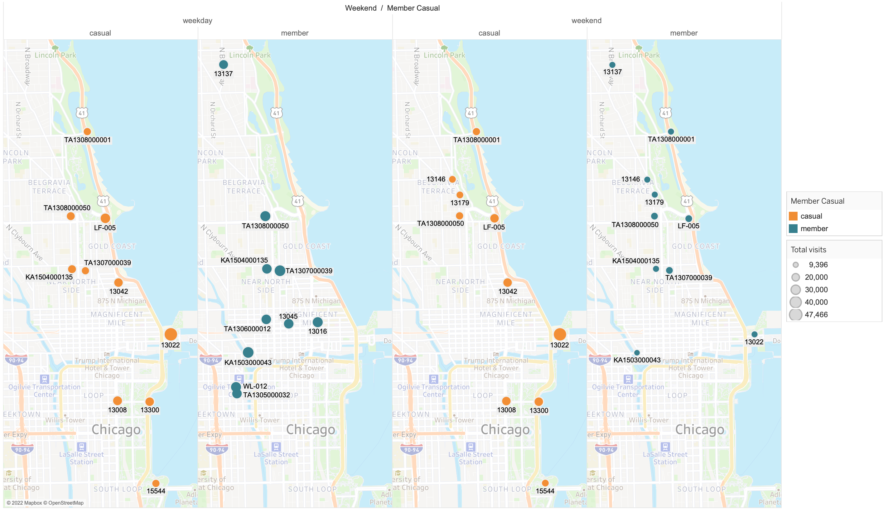
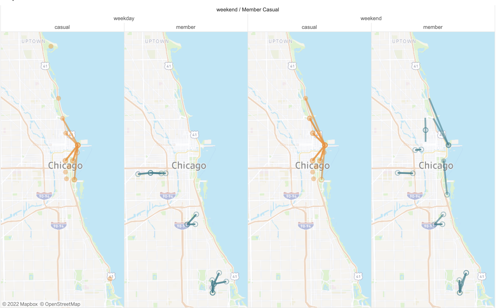
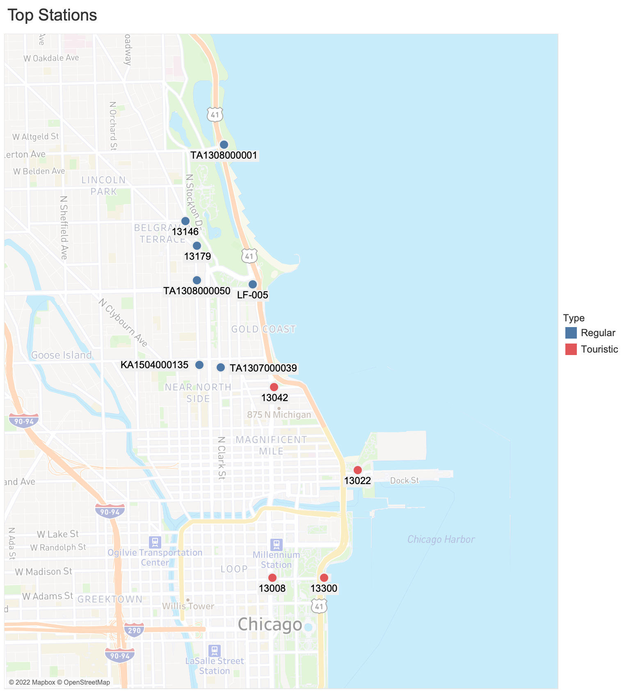

```{r setup, include = F, message = F}
# Markdown options
knitr::opts_chunk$set(echo = T, message = F, cache = F, warning = F)
```

```{r setup2}
# Load packages
library("tidyverse")
library("kableExtra")
library("patchwork")

# Load data
load("data/r_data/data_cleaned.rda")

# Source functions
source("r_scripts/functions.R")
```

```{r logo, echo = FALSE, out.width = '10%'}
htmltools::img(src = knitr::image_uri("images/cyclistic_logo.png"), 
               alt = 'logo', 
               style = 'position:absolute; top:10px; right:100px; padding:10px; max-width: 20%; height: auto;')
```

This is part II of a two-part series on this case study. You can find part I [here](./01_data_processing.html "Cyclistic Case Study Part I - Data Processing").  
The final presentation of the findings can be downloaded as a [Powerpoint](./cyclistic.pptx "Presentation - Powerpoint") or [PDF](./cyclistic.pdf "Presentation - PDF").

# Introduction

## The problem

The problem stems from a case study in Google's Data Analytics Professional Certificate. The goal is to help Cyclistic, a fictitious bike-share company based in Chicago, convert casuals to members. The term casual refers to a user without a membership that either pays for each individual ride or purchases a day pass. Members have annual contracts - more on the specifics later. We have been tasked to identify differences between the two using [historical trip data](https://divvybikes.com/system-data "Original data sets"), which has been provided by [Divvy](https://divvybikes.com/ "Divvy's website"). I wrote a [separate Markdown](./01_data_processing.html "Cyclistic Case Study Part I - Data Processing") in which I processed the data and a [script](./r_scripts/load.R) to import it. The focus of this Markdown is to analyze the data and identify differences between members and casuals that can inform Cyclistic's marketing strategy.

## The data

Let's start with a quick overview of what the data looks like. If you're interested to learn how I arrived at this data set, you can check out the data processing [here](./01_data_processing.html "Cyclistic Case Study Part I - Data Processing").

```{r summary}
# Glimpse
glimpse(data)

# Summarize data
summary(data)
```

The data set is a collection of all Cyclistic bike rides between April 2021 and March 2022. Each observation is a bike ride and the different variables describe various aspects of each ride. Our main variable of interest is `member_casual`, which tells us whether a trip was made by a member or a casual. It will hopefully help us reveal important differences in how members and casuals use Cyclistic's rental bikes. We can group the remaining variables based on the questions they can answer about a trip.

* Was the trip made on a **classic or electric bike**?
  * `rideable_type`

* **How long** did the trip take?
  * `ride_duration`

* **When** did the trip take place?
  * `started_at`
  * `ended_at`
  * `day_of_week`
  * `weekend`
  * `month`
  * `hour`
  * `minute`
  * `second`
  * `date`

* **Where** did the trip start and end?
  * `start_station_name`
  * `start_station_id`
  * `end_station_name`
  * `end_station_id`
  * `start_lat`
  * `start_lng`
  * `end_lat`
  * `end_lng`

In our analysis, we'll mainly look at two independent variables, **frequency, or number of rides**, and **ride duration**, which we'll compare between members and casuals, as well as across a host of other categories. We are going to start with a simple comparison between **members and casuals**. From there, we'll break it up further by **bicycle type** (classic vs electric). Afterwards, we'll look at how classic and electric bike usage fluctuate throughout the **day, week and year** in terms of both ride frequency and duration - all of course while differentiating between members and casuals. Lastly, we are going to examine **where** members and casuals prefer to ride their bikes.

# Basic comparisons

## Members vs. casuals

To get a first impression of the differences between the two groups, we'll compare some simple summary statistics.

```{r table_basic}
# Number of rides and ride duration by member_casual
data %>%
  group_by(member_casual) %>%
  summarize(total_rides = n(),
            mean_duration = mean(ride_duration),
            median_duration = median(ride_duration),
            min_duration = min(ride_duration),
            max_duration = max(ride_duration),
            sd_duration = sd(ride_duration),
            mad_duration = mad(ride_duration)) %>% 
  mutate(percentage = 100*total_rides/sum(total_rides)) %>% 
  relocate(1, 2, "percentage") %>% 
  kable_custom(caption = "Summary statistics by group") %>%
  scroll_box(width = "100%")
```

The 2.199.527 casual rides make up around 41.4% of all rides. Ride duration range is the same in both groups (after we excluded rides with a duration below 1 and above 240 minutes in the [cleaning process](./01_data_processing.html "Cyclistic Case Study Part I - Data Processing"). Casual rides take longer on average and are more dispersed. Following up on these basic differences, we can gain a more thorough understanding of ride durations by looking at their distributions using histograms, a density plot and a cumulative frequency plot.

```{r duration_dist, fig.height = 6}
# Ride duration histogram
histo <- data %>%
  my_ggplot() +
  geom_histogram(aes(x = ride_duration, fill = member_casual),
                 binwidth = 5, boundary = 0, color = "black") +
  coord_cartesian() +
  scale_x_continuous(breaks = seq(0, 240, 30), minor_breaks = seq(0, 240, 10)) +
  scale_y_continuous(breaks = seq(0, 10^6, 2.5*10^5), minor_breaks = NULL,
                     labels = scales::comma) +
  theme(axis.title.x = element_blank()) +
  ylab("Number of rides") +
  facet_wrap(~member_casual, ncol = 1)

# Ride duration density
densplot <- data %>%
  my_ggplot() +
  geom_density(aes(x = ride_duration, color = member_casual)) +
  coord_cartesian() +
  scale_x_continuous(breaks = seq(0, 240, 30), minor_breaks = seq(0, 240, 10)) +
  theme(legend.position = "none", axis.title.x = element_blank())

# Cumulative frequency plot
cumfreq <- data %>%
  my_ggplot(aes(x = ride_duration, color = member_casual)) +
  stat_ecdf() +
  scale_y_continuous(breaks = seq(0, 1, 0.2), labels = scales::percent) +
  scale_x_continuous(breaks = seq(0, 240, 30), minor_breaks = seq(0, 240, 10)) +
  xlab("Ride duration in minutes") +
  ylab("% of total rides") +
  theme(legend.position = "none")

# Combine plots
histo + densplot + cumfreq +
  plot_layout(nrow = 3, heights = c(2, 1, 1)) +
  plot_annotation(title = "Ride duration distribution")
```

In order to properly interpret the data, it is important to understand the pricing structure. We'll assume that Cyclistic uses the same prices as Divvy, which can be found on https://divvybikes.com/pricing. To summarize, classic bikes cost \$0.16 per minute. However, members, who pay \$119 for a yearly subscription, only start paying after 45 minutes. With a day pass, which costs \$15, the first three hours of each ride are free of additional charge. In order to avoid additional payment, members and day pass holders can switch bikes before the time limit is reached, at which point the timer starts over at zero. As a casual without a day pass, you pay \$1 to unlock a classic bike and then start paying \$0.16 per minute immediately. The term casual refers to both non-members with and without a day pass. E-bike prices are \$0.16 per minute for members and \$0.39 per minute plus \$1 to unlock for casuals, regardless of whether they have a day pass or not. With that in mind, we can now get back to interpreting the distribution of ride durations.

Rides between 0 and 10 minutes are far less common in casuals in both absolute and relative terms. This makes sense since casuals, having to pay 1$ to unlock a bike, are probably going to think twice whether it's worth it to pick up a bike or not and day pass holders probably bought a day pass because they are more interested in longer rides. Members on the other hand, for whom every trip shorter than 15 minutes is free of additional charge, might be more likely to pick up a bike even for short trips. The absolute frequency is still lower in casuals for ride durations between 10 and 20 minutes, however, relative frequencies are very similar between both groups. Casuals and members both have similar absolute frequencies for ride durations between 20 and 30 minutes, which means that, given their lower total number of rides, the relative frequency is higher in casuals. Then, as duration increases, the number of rides declines quicker in members, meaning that both absolute and relative frequency for those ride durations are higher in casuals. We can see in the cumulative frequency plot that around 10% of casual trips go beyond the 45 minute threshold, while the same is true for only around 1% of member trips. We can quickly calculate the exact numbers.

```{r table_45_min}
# Table 45 min
data %>%
  group_by(member_casual) %>%
  summarize(percentage_over_45min = 100*sum(ride_duration > 45) / n()) %>% 
  kable_custom(caption = "Percentage of rides longer than 45 minutes")
```

I can think of two explanations for this. One is day pass holders and the other is the fact that members can switch bikes before exceeding 45 minutes to avoid any costs, while for casuals, the per minute price for bike rides actually decreases over time due to the \$1 fee that needs to be paid at the start of every trip. The number of rides becomes indistinguishable from zero after around 60 minutes for members and 120-150 minutes for casuals. The higher dispersion in ride duration in casuals tells us that they are a more heterogeneous group than members. This makes perfect sense, since casuals encompass both non-members with and without a day pass. However, there might be other reasons as well.

## Bicycle type

Now that we have a basic understanding of the differences between members and casuals, we can break the same metrics up further by bicycle type.

```{r table_rideable}
# Summary statistics by member_casual and rideable_type
data %>%
  group_by(member_casual, rideable_type) %>%
  summarize(total_rides = n(),
            mean_duration = mean(ride_duration),
            median_duration = median(ride_duration),
            min_duration = min(ride_duration),
            max_duration = max(ride_duration),
            sd_duration = sd(ride_duration),
            mad_duration = mad(ride_duration)) %>% 
  mutate(percentage = 100*total_rides/sum(total_rides)) %>% 
  relocate(1:3, "percentage") %>% 
  kable_custom(caption = "Summary statistics by group and rideable type") %>%
  scroll_box(width = "100%")
```

E-bike rides are slightly more common in casuals than in members. Ride durations are higher in casuals regardless of bicycle type, which tells us that day passes, which do not include e-bikes, are definitely not the only reason for the between group difference in ride duration. Also, electric bike ride durations are generally lower across both groups. Let's see whether we can find some patterns to explain those differences.

```{r hist_rideable}
# Ride duration histogram by rideable type and membership
data %>%
  my_ggplot() +
  geom_histogram(aes(x = ride_duration, fill = member_casual),
                 binwidth = 5, boundary = 0, color = "black") +
  coord_cartesian() +
  scale_x_continuous(breaks = seq(0, 240, 30), minor_breaks = seq(0, 240, 10)) +
  scale_y_continuous(labels = scales::comma) +
  labs(x = "Ride duration in minutes", y = "Number of rides",
       title = "Ride frequency by ride duration",
       subtitle = "By membership and rideable type") +
  facet_grid(rows = vars(member_casual), cols = vars(rideable_type))
```

```{r cumfreq_rideable}
# Cumulative frequency plot
data %>%
  my_ggplot(aes(x = ride_duration,
                color = member_casual,
                linetype = rideable_type)) +
  stat_ecdf() +
  scale_y_continuous(breaks = seq(0, 1, 0.2), labels = scales::percent) +
  scale_x_continuous(breaks = seq(0, 240, 30), minor_breaks = seq(0, 240, 10)) +
  labs(x = "Ride duration in minutes", y = "Number of rides",
       title = "Cumulative ride frequency by ride duration",
       subtitle = "By membership and rideable type")
```

While e-bike rides are on average shorter than classic bike rides, there don't seem to be any particular patterns to explain those differences. It makes sense that e-bike trips tend to be shorter than classic ones since e-bikes are more expensive per minute, start charging per minute straight from the start even for members and allow most people to travel faster than on classic bikes. Hence, customers might be more careful not to use e-bikes for too long and, when used for the same routes, e-bikes should allow for shorter trip durations than classic bikes.

Even though there are clear differences between classic and e-bikes, these differences seem to be similar across members and casuals and thus do not reveal a lot about the differences between the two groups. It is important to note that the difference in e-bike ride duration between casuals and members cannot be attributed to day passes or the 45 minute threshold, since both don't apply to e-bikes. However, members do not need to pay to unlock an e-bike, so they might again be more willing to pick it up for shorter durations. This is reflected in the far higher number of e-bike rides lasting less than 10 minutes in members.

# Temporal differences

## Days of the week

Looking at how bike usage patterns vary over time, we are going to start with daily differences throughout the week. Differences between weekdays and weekends could be particularly insightful and it might make sense to differentiate between the two later on, when looking at hourly and monthly fluctuations throughout the day and year.

```{r rides_day}
# Mean number of rides per day of the week
data %>%
  group_by(day_of_week) %>% 
  mutate(n_days = n_distinct(date)) %>% 
  group_by(member_casual, rideable_type, day_of_week, weekend) %>% 
  summarize(n = n()/mean(n_days)) %>%
  my_ggplot(aes(x = day_of_week, y = n,
             fill = member_casual,
             color = weekend)) +
  geom_bar(stat = "identity") +
  coord_cartesian(ylim = c(0, NA)) +
  scale_color_manual(values = c("weekday" = "white", "weekend" = "black"),
                     guide = "none") +
  theme(axis.text.x = element_text(face = c(rep("plain", 5), "bold", "bold"))) +
  labs(x = NULL, y = "Mean number of rides",
       title = "Mean number of rides per day of the week",
       subtitle = "by membership and rideable type") +
  facet_grid(rows = vars(member_casual), cols = vars(rideable_type))
```

The number of trips is relatively constant on weekdays in all four groups with around twice as many daily classic and slightly more electric bike rides in members compared to casuals. As we saw earlier, classic bike usage is only slightly higher than e-bike usage in casuals, whereas members clearly seem to prefer classic bikes over electric ones. On weekends, casuals rent notably more classic and slightly more electric bikes than during the week. In members, on the other hand, the number of trips stays constant or even slightly decreases on weekends. This could be an indication that casuals tend to rent bikes for more leisure activities. We know from the case study description, that around 30% of Cyclistic customers use their bikes to commute to work. Assuming that the majority of people work during the week rather than on weekends, the bulk of those 30% might be members. We'll investigate this further by researching how bike rides vary over the course of a day after we compare ride durations between different days.

```{r duration_day}
# Median ride duration by day of the week
data %>%
  group_by(member_casual, rideable_type, day_of_week, weekend) %>% 
  summarize(ride_duration = median(ride_duration)) %>% 
  my_ggplot(aes(x = day_of_week, y = ride_duration,
             fill = member_casual,
             color = weekend)) +
  geom_bar(stat = "identity") +
  coord_cartesian(ylim = c(0, NA)) +
  scale_color_manual(values = c("weekday" = "white", "weekend" = "black"),
                     guide = "none") +
  theme(axis.text.x = element_text(face = c(rep("plain", 5), "bold", "bold"))) +
  labs(x = NULL, y = "Median ride duration",
       title = "Median ride duration by day of the week",
       subtitle = "by membership and rideable type") +
  facet_grid(rows = vars(member_casual), cols = vars(rideable_type))
```

Median ride durations are slightly higher on weekends regardless of membership and rideable type. This does not add a lot of insight, but makes sense, since people usually have more time to spare on weekends. They can be more relaxed on leisure rides, whereas they might be more rushed on commutes.

```{r hist_day}
# Ride duration histogram weekday vs weekend
data %>%
  group_by(weekend) %>% 
  mutate(n_days = n_distinct(date)) %>% 
  mutate(ride_duration = cut(ride_duration, seq(0,240,5))) %>% 
  group_by(member_casual, weekend, ride_duration) %>% 
  summarize(n = n()/mean(n_days)) %>%
  mutate(ride_duration = seq(0,235,5)+2.5) %>% 
  my_ggplot() +
  geom_col(aes(x = ride_duration, y = n, fill = member_casual), color = "black") +
  coord_cartesian() +
  scale_x_continuous(breaks = seq(0,240,30), minor_breaks = seq(0, 240, 10)) +
  scale_y_continuous(labels = scales::comma) +
  xlab("Ride duration in minutes") +
  ylab("Mean daily number of rides") +
  labs(title = "Ride duration histogram", subtitle = "Number of mean daily rides") +
  facet_grid(rows = vars(member_casual), cols = vars(weekend))
```

In casuals, the number of rides increases evenly across all bins on weekend days, except for rides between 0 and 5 minutes, which stay around the same. In members, there are fewer rides below 15 minutes on weekends, but the number of longer rides is almost unchanged. The higher number of overall rides on weekends in casuals seems to be related to an even increase in the number of rides across all durations above 5 minutes. The overall slight decrease in the number of member rides on weekends seems to be mostly caused by a decrease in rides shorter than 15 minutes, which could be related to the lower number of commutes on weekends. Let's dig even deeper and look into classic vs electric bikes. We can use a line graph to allow better comparisons between multiple groups. The following line graph is basically a histogram using a bin width of one minute.

```{r freq_day_rideable}
# Ride duration distribution weekday vs weekend by rideable_type
data %>%
  group_by(weekend) %>% 
  mutate(n_days = n_distinct(date)) %>% 
  ungroup() %>% 
  mutate(ride_duration = cut(ride_duration, seq(0,240,1))) %>% 
  group_by(member_casual, weekend, rideable_type, ride_duration) %>% 
  summarize(n = n()/mean(n_days)) %>%
  mutate(ride_duration = row_number()-0.5) %>% 
  my_ggplot() +
  geom_line(aes(x = ride_duration, y = n, color = member_casual, linetype = weekend),
            alpha = 0.8) +
  coord_cartesian() +
  scale_x_continuous(breaks = seq(0,240,30), minor_breaks = seq(0, 240, 10)) +
  scale_y_continuous(labels = scales::comma) +
  xlab("Ride duration in minutes") +
  ylab("Number of rides") +
  ggtitle("Number of rides lasting x minutes") +
  facet_wrap(~rideable_type)
```

This graph confirms our previous findings and also shows that, in casuals, e-bike usage only differs slightly between weekends and weekdays, whereas the difference is much bigger in classic bikes.

## Times of day

```{r rides_hour}
# Average number of rides by hour
data %>% 
  group_by(weekend) %>% 
  mutate(n_days = n_distinct(date)) %>% 
  group_by(member_casual, weekend, rideable_type, hour) %>% 
  summarize(n = n()/mean(n_days)) %>%
  my_ggplot(aes(x = hour, y = n,
             color = member_casual,
             linetype = rideable_type)) +
  geom_point() +
  geom_line(aes(group = interaction(member_casual, rideable_type))) +
  scale_x_continuous(breaks = seq(0,20,4),
                     labels = c("12am", "4am", "8am", "12pm", "4pm", "8pm")) +
  coord_cartesian(ylim = c(0, NA)) +
  labs(x = NULL, y = "Mean number of rides",
       title = "Mean number of rides by hour",
       subtitle = "by membership and rideable type") +
  facet_wrap(~weekend, nrow = 1)
```

On weekdays, there are two distinct peaks in the number of rides in members. These happen between around 6am and 9am and between 3pm and 7pm. They are very likely caused by commutes. The same peaks are not visible in casuals, although they too display a sharp increase in rides after 3pm, but only a very minor one in the morning. This reinforces our hypothesis that members are more likely to rent bikes to commute to work. Other than these peaks, particularly the one in the morning, the fluctuations look similar between groups. This suggests that there might be certain members and casuals that display similar user habits, on top of which there are unique members that are responsible for the differences between both groups (alias the the morning peak). Weekend usage patterns are almost identical between members and casuals. Differences and similarities between both groups are independent of bicycle type.

```{r duration_hour}
# Ride duration by time of day
data %>%
  group_by(member_casual, rideable_type, hour, weekend) %>% 
  summarize(ride_duration = median(ride_duration)) %>% 
  my_ggplot(aes(x = hour, y = ride_duration,
             color = member_casual,
             linetype = rideable_type,
             group = interaction(member_casual, rideable_type))) +
  geom_point() +
  geom_line() +
  scale_x_continuous(breaks = seq(0,20,4),
                     labels = c("12am", "4am", "8am", "12pm", "4pm", "8pm"),
                     minor_breaks = 0:23) +
  scale_y_continuous(labels = scales::comma) +
  coord_cartesian(ylim = c(0, NA)) +
  labs(x = NULL, y = "Median ride duration",
       title = "Median ride duration by time of the day",
       subtitle = "by membership and rideable type") +
  facet_wrap(~weekend, ncol = 2)
```

There is a distinct dip in ride duration on weekdays after 3am. People probably want to get home (or wherever they want to get to) as quickly as possible, causing them to go fast and possibly even get bikes for short distances that they might otherwise walk. This might also be related to other means of public transport being limited during this time of day. Between 6am and 8am, a steep increase in member ride duration causes ride duration to become almost identical between both groups. It is possible that, regardless of group, pretty much every trip in this time period is a commute with similar distances and thus durations in both groups. After this short period in which casuals and members form a relatively homogeneous group, their usual differences show again in higher ride duration in casuals. In the afternoon, the higher number of overall rides means that commuters do not have the same impact on mean and median ride duration that they have in the morning when there are barely any other rides.

## Months

```{r rides_month}
# Mean number of daily rides by month
data %>% 
  group_by(month, weekend) %>% 
  mutate(n_days = n_distinct(date)) %>% 
  group_by(member_casual, weekend, rideable_type, month) %>% 
  summarize(n = n()/mean(n_days)) %>%
  my_ggplot(aes(x = month, y = n,
             color = member_casual,
             linetype = rideable_type)) +
  geom_point() +
  geom_line(aes(group = interaction(member_casual, rideable_type))) +
  coord_cartesian(ylim = c(0, NA)) +
  theme(axis.text.x = element_text(angle = 45, hjust = 1, vjust = 1)) +
  labs(x = NULL, y = "Mean daily number of rides",
       title = "Mean daily number of rides by month",
       subtitle = "by membership and rideable type") +
  facet_grid(rows = vars(rideable_type), cols = vars(weekend))
```

As expected, both members and casuals are most active during the summer and least active in the winter. E-bike rides follow a slightly different distribution. While the summer is, overall, still more popular than other seasons, there are also peaks March and October. Patricularly members tend to use e-bikes on weekdays at least as much from October to November as they do from June to September. This could mean that some commuters switch to e-bikes when it gets cold.
Since members pay for the whole year, it is no surprise that their monthly fluctuations in bike usage are lower than those of casuals. This difference is least prominent for classic bikes on weekdays, even though this can partly be explained by members switching to e-bikes during the colder months. The biggest difference can be seen on weekends, where bike usage is higher in casuals only between May and September (October for e-bikes).

```{r duration_month}
# Ride duration by month
data %>%
  group_by(member_casual, rideable_type, month, weekend) %>% 
  summarize(ride_duration = median(ride_duration)) %>% 
  my_ggplot(aes(x = month, y = ride_duration,
             color = member_casual,
             linetype = rideable_type,
             group = interaction(member_casual, rideable_type))) +
  geom_point() +
  geom_line() +
  scale_y_continuous(labels = scales::comma) +
  coord_cartesian(ylim = c(0, NA)) +
  labs(x = NULL, y = "Median ride duration",
       title = "Median ride duration by month",
       subtitle = "by membership, rideable type and type of day") +
  facet_wrap(~weekend, ncol = 2)
```

Ride duration is highest in spring in all groups. I don't see any interesting patterns or interactions.

Here is a **summary** of ride frequency and duration:

* Casuals make up for around 40% of overall bike rides.
* Ride durations are higher in casuals which can be explained by the 45 minute threshold, unlocking fee and day passes.
* E-bike rides are slightly more common in casuals.
* Casuals are more active on weekends, while members are slightly more active on weekdays.
* Ride durations are slightly higher on weekends, mostly due to fewer short trips in members and more long trips in casuals.
* Fluctuations in ride frequency throughout the day are similar between the groups on weekdays and weekends, except for two peaks on weekdays between 6am and 9am and 3pm and 7pm, that are more pronounced in members.
* Ride duration dips in casuals during the first peak, eliminating the otherwise stable difference between members and casuals.
* Both members and casuals are more active during warmer months. This effect is the strongest for casuals on weekends. The average daily ride frequency is only higher in casuals than members on weekends during the summer.
* Ride duration is highest in spring with fluctuations over the year being similar between all groups and rideable types.
* Differentiating between e-bikes and classic bikes does not reveal any relevant group differences or interactions between group and rideable type.

# Geographic differences

## Stations

Other than **when** members and casuals use our bikes, we can also look at differences in terms of **where** they use them. We could use these insights to develop a marketing campaign e.g. by advertising or planning events at specific stations. In order to do so, let's look at the most popular stations. We'll also keep differentiating between weekdays and weekends, as we now know that there are substantial differences between the two in terms of customer behavior. In order to do all that, I'll use Tableau Public. Without a credit card, I cannot enable the Google Maps API, which makes it a lot harder to create a good looking map in R. Accordingly, I chose to use Tableau and paste the images here. You can find the original Visualizations [here](https://public.tableau.com/app/profile/alexander.greif/viz/Trips_and_Stations_wide/Stations "Stations Viz") and [here](https://public.tableau.com/app/profile/alexander.greif/viz/Trips_and_Stations_wide/Trips "Trips Viz"). And [this](./r_scripts/tableau.R) is the script I used to transform the data for use in Tableau.



The differences between weekdays and weekends are more pronounced in members. This makes perfect sense since the high number of commutes during the week means that there is going to be a larger difference compared to weekends, when the number of commutes is significantly lower. This is further supported by the higher similarities in stations between members and casuals on weekends compared to weekdays. A lot of the casuals' favorite stations, as well as some stations that are popular among members on weekends, are located around the coast and parks, while the stations most frequently used by members (especially during the week) are predominantly located in Chicago's business district.

It seems that casuals behave similarly on weekends as they do on weekdays, as they preferably use Cyclistic bikes for leisure time activities on both. Members, on the other hand, show larger differences between weekends and weekdays, indicating that during the week, they primarily use our bikes to commute, while on weekends, they rent bikes for leisure time activities, similarly to casuals.

## Trips

We can also look at people's favorite trips rather than just stations.



* Only start stations are highlighted as circles, so if two circles are connected by a line, both directions of that route are in the top 20.
* Filled circles represent round trips.

This comparison between trips reflects a lot of the same patterns as the one between stations. Furthermore, we can see that round trips are a lot more popular among casuals, adding even more support to our previous hypothesis, given that a round trip cannot be a commute. There are three distinct areas in which all of the 20 most frequent weekday trips occur in members. All three are university campuses and each of the trips is performed between 3 and 14 times per weekday. Apparently, Cyclistic is highly popular among university students and/or professionals. I was going to check how popular those trips and stations are among casuals and then possibly suggest partnering with universities for promotion. However, I checked Divvy's website and found that they already have partnerships with various universities. It is possible though, that those partnerships are not very well advertised, making them a possible target for our campaign. Let's see how these routes are doing among casuals.

```{r table_unis}
# Top 20 weekday trips for members
top20 <- data %>%
  filter(!is.na(start_station_id) & !is.na(end_station_id) &
           member_casual == "member" & weekend == "weekday") %>% 
  group_by(member_casual, weekend, start_station_id, end_station_id) %>% 
  summarize(n = n()) %>% 
  arrange(desc(n)) %>%
  ungroup() %>% 
  slice_head(n = 20) %>% 
  select(start_station_id, end_station_id)

# Trips in other groups
top20 <- data %>% 
  group_by(weekend) %>% 
  mutate(n_days = n_distinct(date)) %>%
  inner_join(top20, by = c("start_station_id", "end_station_id")) %>%
  group_by(member_casual, weekend, start_station_id, end_station_id) %>% 
  summarize(n = n(),
            n_daily = round(n/mean(n_days), 1)) %>% 
  arrange(desc(n)) %>% 
  mutate(n = paste0(n, " (", n_daily, ")")) %>% 
  select(-n_daily) %>% 
  group_by(member_casual, weekend) %>% 
  slice_head(n = 20) %>% 
  pivot_wider(names_from = c("member_casual", "weekend"), values_from = c("n"))

top20 %>%
  kable_custom(caption = "Total (mean daily) rides for university routes") %>%
  scroll_box(width = "100%", height = "300px")
```

With the most popular route amounting to 722 weekday rides over the course of the year, or around 3 per weekday, there does not seem to be a lot of potential in casuals at universities. There might be huge potential in universities overall since, even though the 20 most popular trips among members are all on university campuses, the numbers are still relatively low compared to the number of enrolled students. However, this is beyond our scope, as our aim is converting casuals not members, rather than recruiting entirely new customers.

Here is a short **summary** of our geographic analysis:

* Casuals target similar stations on weekdays and weekends.
* These stations are predominantly located around the coast and parks.
* Members behave differently between weekdays and weekends.
* During the week, members are mostly active in the business district and on university campuses. 
* On weekends, members behave more similarly to casuals. They target areas around the coast and parks, while still being active, albeit to a lesser degree, in central areas and on university campuses.
* Round trips are a lot more popular among casuals.

# Analysis of the most relevant stations

## Rationale

If we want to use our knowledge of the most popular stations to organize events, it is important to know when these stations are most busy. Even though we know when the majority of rides take place in general, we cannot be sure whether that is true for each individual station. When aiming to choose stations from which we can convert the highest number of members, there are two things we need to look for:

1. The total number of casuals visiting that station.
2. The likelihood for those casuals to convert.

While the first one is straightforward, the second one is a lot harder to assess. What makes a person likely to sign up for a membership? Unfortunately, we don't have any data on our members, so we'll have to speculate using common sense. Locals will be more likely to become members than people from outside of Chicago. The same is true to a lesser degree for outsiders that regularly visit Chicago. These people might be professionals working in Chicago or regularly going there for business trips, or they might be tourists from the surrounding area that visit regularly. Tourists that visit Chicago only once or twice a year, or even less often, will very likely not become Cyclistic members. We unfortunately have no access to any personal information, including addresses, of our customers. The data set we are working with contains no personal identifiers. This means that we don't know whether a customer rented a bike more than once. For all we know, it would be possible that no two trips in our data set were made by the same customer. Without all this information, we need to use our knowledge of when a trip occurs to deduce whether a customer is more or less likely to be local. I believe it is not too far fetched, for example, that the percentage of non-local tourists is higher on weekends. There are more tourists in town and the number of commutes should be significantly lower. We can further use common sense and our previously attained knowledge of customer activity patterns to divide weekdays into four distinct time periods, each associated with a certain customer demographic:

* **7am to 9am**: This is when the percentage of locals should be highest because the majority of rides are probably commutes.
* **9am to 4pm**: This is probably when the percentage of locals is lowest because a lot of them are at work.
* **4pm to 7pm**: The percentage of locals should be second highest because of commutes. However, compared to the morning, there is also a higher number of non-commute bike rides.
* **7pm to 6am**: The percentage of locals is third highest. The majority of rides are probably leisure rides performed by both locals and non-locals.

If, for example, a station is highly busy in the morning, that probably means that it is used a lot by commuters. If there is a notable number of casuals among those commuters, then these are exactly the individuals that should be relatively easy to convert to members. On the other hand, if a station is mostly busy between 9am and 4pm, then that might be an indicator that it is mostly used by non-locals. However, it is important to also consider how members use a station. For example, if a station is really popular among members between 9am and 4pm, it is more likely that the casuals using it at the same time are inclined to sign up for a membership, as they apparently share some characteristics with a lot of members. Overall, if a station is used similarly by members and casuals, that is something to keep an eye on. Furthermore, we can look at monthly fluctuations at specific stations. If a station is busy year-round, it should be at least in part due to certain people using it year-round. These people should be easier to convert to members. To sum up, there are three things that we are looking for in a station in terms of the likelihood of its users to convert to members:

1. During which time periods throughout the day is the station most busy?
2. Is the station busy year-round?
3. Do members and casuals display similar activity patterns?

The first point is less important on weekends, when there don't seem to be any distinct time periods that reflect certain types of customers. We can use the data to 1) assess the total number of casuals visiting each stations and 2) estimate how likely the casuals at those stations are to convert. We obviously cannot do that for all 3334 stations, so we'll focus on the top 10 stations that we've identified before. We identfied a top 10 for four subgroups. Due to the overlap between the four groups, this leaves us with 19 unique stations. We'll even include the stations that were not in the top 10 in casuals for either weekdays or weekends. Even though their total casual visits did not place them in the top 10, the fact that they are so popular among members might mean that the casuals using them might be more likely to convert. 

## Identifying the right stations

Let's begin by examining overall visits by casuals and members for each of the 19 stations on weekdays and weekends. We'll sort them by casual visits from highest to lowest.

```{r top10}
# Find top 10 after 4pm  <-  in casuals
stations <- data %>%
  group_by(weekend) %>% 
  mutate(n_days = n_distinct(date)) %>%
  pivot_longer(cols = c("start_station_id", "end_station_id"),
               names_to = c("type", ".value"),
               names_pattern = '(^[^_]+(?=_))_(.*)') %>%
  filter(!is.na(station_id)) %>% 
  group_by(member_casual, weekend, station_id) %>% 
  summarize(total_rides = n_distinct(ride_id),
            mean_rides = total_rides/mean(n_days),
            total_visits = n(),
            mean_visits = total_visits/mean(n_days)) %>%
  arrange(desc(total_rides)) %>% 
  mutate(number = row_number())

# Factor ordered by traffic in casuals overall
stations <- stations %>%
  ungroup() %>% 
  filter(member_casual == "casual") %>%
  mutate(id_ordered = reorder(station_id, desc(total_rides))) %>%
  select(station_id, id_ordered, weekend) %>% 
  right_join(stations, by = c("station_id", "weekend"))

# Reorder weekday ID
stations <- stations %>%
  ungroup() %>% 
  filter(member_casual == "casual" & weekend == "weekday") %>%
  mutate(id_weekday = reorder(station_id, number)) %>%
  select(station_id, id_weekday, weekend) %>% 
  right_join(stations, by = c("station_id", "weekend"))

# Reorder weekend ID
stations <- stations %>%
  ungroup() %>% 
  filter(member_casual == "casual" & weekend == "weekend") %>%
  mutate(id_weekend = reorder(station_id, number)) %>%
  select(station_id, id_weekend, weekend) %>% 
  right_join(stations, by = c("station_id", "weekend"))

# Top 10 stations
top10 <- stations %>%
  filter(number <= 10) %>% 
  ungroup() %>% 
  mutate(group = interaction(member_casual, weekend),
         n = 1) %>%
  select(station_id, group, n) %>%
  pivot_wider(names_from = "group", values_from = "n", values_fill = list(n = 0))

# Plot
stations %>%
  ungroup() %>% 
  filter(station_id %in% top10$station_id) %>%
  my_ggplot(aes(x = mean_rides,
                y = id_ordered,
                fill = member_casual)) +
  geom_col(position = position_dodge2(reverse = T)) +
  scale_y_discrete(limits=rev) +
  theme(axis.title.y = element_blank()) +
  labs(title = "Mean daily number of rides", subtitle = "Top 10 stations") +
  facet_wrap(~weekend, ncol = 2, scales = "free_x")
```

On weekdays, the more popular stations among casuals are generally the less popular ones among members, although there are some exceptions to this. The pattern looks a bit different on weekdays, where the most popular stations in one group enjoy average popularity in the other group. The least popular stations are mostly the same in both groups. Overall, station 13022 really stands out in that it is by far the busiest and involved in the majority of top 20 trips among casuals on both weekdays and weekends. However, its popularity among members is significantly lower. We'll leave out station 13022 for the upcoming analyses of station station traffic by month and hour. Its traffic is so high that its inclusion would negatively affect readability for other stations by scaling the y-axis. We'll obviously look into this station later though.

```{r plot_traffic_function}
# Function to plot traffic
plot_traffic <- function (x, ids_df, stations, days_by, plot_by) {
  # Summarize x
  x <- x %>% 
  group_by(across(all_of(days_by))) %>%
  mutate(n_days = n_distinct(date)) %>% 
  filter(start_station_id %in% stations |
            end_station_id %in% stations) %>% 
  select(start_station_id, end_station_id, ride_id, member_casual,
         weekend, month, started_at, hour, n_days) %>% 
  pivot_longer(cols = c("start_station_id", "end_station_id"),
               names_to = c("type", ".value"),
               names_pattern = '(^[^_]+(?=_))_(.*)') %>% 
  filter(station_id %in% stations) %>%
  group_by(station_id, member_casual,
           across(all_of(unique(c(days_by, plot_by))))) %>% 
  summarize(n = n_distinct(ride_id)/mean(n_days))
  
  # Join to reorder stations
  x <- left_join(x, ids_df, by = c("station_id", "weekend"))
  
  # Plot
  x %>% 
    my_ggplot(aes(x = !!sym(plot_by), y = n,
             color = member_casual)) +
    geom_point() +
    geom_line(aes(group = member_casual)) +
    coord_cartesian(ylim = c(0, NA))
}
```

```{r top10_month, fig.width=12, fig.height=8}
# Plot by month for weekdays and weekends
plot_list <- list()
day_type <- c("weekday", "weekend")
titles <- c("Weekdays", "Weekends")
for (i in 1:2) {
  plot_list[[i]] <- data %>% 
    filter(weekend == day_type[i]) %>%
    plot_traffic(select(stations, station_id, weekend, starts_with("id_")),
                 stations = top10$station_id[top10$station_id != "13022"],
                 days_by = c("weekend", "month"),
                 plot_by = "month") +
    facet_wrap(~id_ordered, ncol = 9, as.table = T) +
    theme(axis.text.x = element_text(angle = 90, hjust = 1, vjust = 0.5)) +
    labs(x = NULL, y = "Mean daily rides",
         subtitle = titles[i])
}

plot_list[[2]] <- plot_list[[2]] + theme(legend.position = "none")

plot_list[[1]] + plot_list[[2]] +
  plot_layout(ncol = 1) +
  plot_annotation(title = "Mean daily rides by month",
                  subtitle = "Top stations")
```

```{r top10_hour, fig.width=12, fig.height=8}
# Plot
plot_list <- list()
day_type <- c("weekday", "weekend")
titles <- c("Weekdays", "Weekends")
for (i in 1:2) {
  plot_list[[i]] <- data %>%
    filter(weekend == day_type[i]) %>% 
    plot_traffic(select(stations, station_id, weekend, starts_with("id_")),
                 stations = top10$station_id[top10$station_id != "13022"],
                 days_by = c("weekend"),
                 plot_by = "hour") +
    facet_wrap(~id_ordered, ncol = 9, as.table = T) +
    scale_x_continuous(breaks = seq(0,20,4),
                     labels = c("12am", "4am", "8am", "12pm", "4pm", "8pm")) +
    theme(axis.text.x = element_text(angle = 45, hjust = 1, vjust = 1)) +
    labs(x = NULL, y = "Mean hourly rides",
         subtitle = titles[i])
}

plot_list[[2]] <- plot_list[[2]] + theme(legend.position = "none")

plot_list[[1]] + plot_list[[2]] +
  plot_layout(ncol = 1) +
  plot_annotation(title = "Mean hourly rides",
                  subtitle = "Top stations")
```

As a reminder, we are looking for stations that are 1) busy in the morning and/or afternoon, before/after normal working hours, 2) simultaneously busy in members and casuals, 3) busy year-round and 4) highly popular among casuals in general.

Right of the bat we can see that casual activity never peaks in the morning. However, it does peak in the afternoon in a lot of stations. An afternoon peak that is higher than the morning peak for that station likely means that a substantial number of the rides in that afternoon peaks are not commutes, but rather after-work leisure rides. The same is obviously true for a completely missing morning peak. Accordingly, in line with our previous findings, casuals seem to barely use Cyclistic bikes to commute. However, they do use them a lot for after-work leisure rides. The stations with a pronounced afternoon peak are highly interesting to us, because the proportion of locals compared to non-locals should be highest around that time. There are five stations with no true afternoon peak: 13008, 13042, 13300, 15544 and 13016. The first three stations have pretty low member activity on both weekdays and weekends. However, they are among the most visited stations by casuals and thus not totally irrelevant to us.

Station 15544 behaves completely different from the rest of the stations. It has a very distinct peak at around 1pm to 2pm on weekdays and weekends and is basically not used at all by members. It is located at the Shedd Aquarium, Adler Planetarium and Field Museum which close at 6pm, 4pm and 5pm. The area is highly touristic and thus the large majority of people using the station are very likely tourists. Overall, the number of visiting casuals is not extraordinarily high. This station is not very interesting to us. Lastly, station 13016 has very low casual activity in general and is only included because member activity is very high, mostly due to commutes. It too is thus irrelevant to us.

There is an afternoon peak in casual activity in all 13 remaining stations. For all these stations, casuals behave somewhat similar to members. However, a lot of them have very low overall casual traffic. Most of these stations could be good targets for something like poster advertising, but only a few of them are busy enough for promotional events to make sense. In my opinion, these are LF-005, TA1308000050, KA1504000135, TA1307000039, TA1308000001, 13179 and 13146. Let's quickly examine station 13022 now.

```{r plot_13022, fig.width = 9, fig.height = 4}
# Plot by month for weekdays and weekends
plot_month <- data %>%
    plot_traffic(select(stations, station_id, weekend, starts_with("id_")),
                 stations = "13022",
                 days_by = c("weekend", "month"),
                 plot_by = "month") +
    facet_wrap(~weekend) +
    theme(axis.text.x = element_text(angle = 90, hjust = 1, vjust = 0.5)) +
    labs(x = NULL, y = "Mean daily rides", subtitle = "By month")

# Plot by hour for weekdays and weekends
plot_hour <- data %>%
    plot_traffic(select(stations, station_id, weekend, starts_with("id_")),
                 stations = "13022",
                 days_by = c("weekend"),
                 plot_by = "hour") +
    facet_wrap(~weekend) +
    scale_x_continuous(breaks = seq(0,20,4),
                     labels = c("12am", "4am", "8am", "12pm", "4pm", "8pm")) +
    theme(axis.text.x = element_text(angle = 45, hjust = 1, vjust = 1)) +
    labs(x = NULL, y = "Mean hourly rides", subtitle = "By hour")

plot_month + plot_hour +
  plot_layout(ncol = 2) +
  plot_annotation(title = "Station activity",
                  subtitle = "Station 13022")
```

We have already seen the station's popularity in the map we've created earlier. It is by far the most popular station in casuals and involved in the majority of the casuals' top 20 favorite trips on both weekdays and weekends. Its higher popularity on weekdays compared to weekends and in casuals compared to members, as well as its location on the coast, where already indicative of it being mostly touristic. The tiny morning and afternoon peaks further support this hypothesis. However, just like stations 13008, 13042 and 13300, the station remains interesting due to its extremely high overall casual usage. This leaves us with a total of eleven stations to further examine. We can split them into two groups:

* Regular stations (LF-005, TA1308000050, KA1504000135, TA1307000039, TA1308000001, 13179 and 13146)
  * Significant spike in activity on weekdays after 4pm
  * Similar popularity in members
  * Presumably higher percentage of locals and not quite as touristic
  * Possibly higher convertibility
* Touristic stations (13022, 13008, 13042 and 13300)
  * Overall highest casual activity of all stations (except LF-005)
  * Longer peak activity, starting at around 1pm
  * Not as popular in members
  * Presumably fewer locals and higher percentage of tourists
  * Possibly lower convertibility
  
{height=600px}
  
## Activity patterns

If we were to hold an event, it would make sense to do so at the start of the season. Since activity peaks somewhere around June/July/August for all stations, it makes sense to hold events around May/June. Let's see how many people we would be able to reach during the busiest time of day in those months. We'll look at both groups of stations individually.

```{r regular_hour, fig.width=12, fig.height=8}
# Stations
stations_regular <- c("LF-005", "TA1308000050", "KA1504000135", "TA1307000039",
                   "TA1308000001", "13179", "13146")

# Plot
plot_list <- list()
day_type <- c("weekday", "weekend")
titles <- c("Weekdays", "Weekends")
for (i in 1:2) {
  plot_list[[i]] <- data %>%
    filter(weekend == day_type[i] & month %in% c("May", "Jun")) %>% 
    plot_traffic(select(stations, station_id, weekend, starts_with("id_")),
                 stations = stations_regular,
                 days_by = c("weekend", "month"),
                 plot_by = "hour") +
    facet_grid(cols = vars(id_ordered),
               rows = vars(month),
               as.table = T) +
    scale_x_continuous(breaks = seq(0,20,4),
                     labels = c("12am", "4am", "8am", "12pm", "4pm", "8pm")) +
    theme(axis.text.x = element_text(angle = 45, hjust = 1, vjust = 1)) +
    labs(x = NULL, y = "Mean hourly rides",
         subtitle = titles[i])
}

plot_list[[2]] <- plot_list[[2]] + theme(legend.position = "none")

plot_list[[1]] + plot_list[[2]] +
  plot_layout(ncol = 1) +
  plot_annotation(title = "Mean hourly rides by month",
                  subtitle = "Regular stations")
```

All stations are significantly busier in June. Let's see whether the same is true for the four more touristic stations.

```{r tourist_hour, fig.width=12, fig.height=8}
# Stations
stations_tourist <- c("13022", "13008", "13042", "13300")

# Plot
plot_list <- list()
day_type <- c("weekday", "weekend")
titles <- c("Weekdays", "Weekends")
for (i in 1:2) {
  plot_list[[i]] <- data %>%
    filter(weekend == day_type[i] & month %in% c("May", "Jun")) %>% 
    plot_traffic(select(stations, station_id, weekend, starts_with("id_")),
                 stations = stations_tourist,
                 days_by = c("weekend", "month"),
                 plot_by = "hour") +
    facet_grid(cols = vars(id_ordered),
               rows = vars(month),
               as.table = T) +
    scale_x_continuous(breaks = seq(0,20,4),
                     labels = c("12am", "4am", "8am", "12pm", "4pm", "8pm")) +
    theme(axis.text.x = element_text(angle = 45, hjust = 1, vjust = 1)) +
    labs(x = NULL, y = "Mean hourly rides",
         subtitle = titles[i])
}

plot_list[[2]] <- plot_list[[2]] + theme(legend.position = "none")

plot_list[[1]] + plot_list[[2]] +
  plot_layout(ncol = 1) +
  plot_annotation(title = "Mean hourly rides by month",
                  subtitle = "Touristic stations")
```

June is clearly busier than May in all stations. The differences are particularly pronounced on weekdays. We can try to find the best time to start a promotion by plotting the average number of visits during busiest period of the day by calendar week. We'll use 4pm to 10pm for weekdays and 11am to 5pm for weekends for the regular stations.

```{r regular_weeks, fig.width = 9, fig.height = 6}
# Regular stations weekly peak hours traffic
data %>%
filter(month %in% c("May", "Jun", "Jul")) %>%
  group_by(weekend, week) %>% 
  mutate(n_days = n_distinct(date)) %>%
  filter((start_station_id %in% stations_regular |
            end_station_id %in% stations_regular) &
           (between(hour, 16, 22) & weekend == "weekday") |
           (between(hour, 11, 17) & weekend == "weekend")) %>%
  pivot_longer(cols = c("start_station_id", "end_station_id"),
               names_to = c("type", ".value"),
               names_pattern = '(^[^_]+(?=_))_(.*)') %>% 
  filter(station_id %in% stations_regular) %>%
  group_by(station_id, weekend, member_casual, week) %>%
  summarize(n = n()/mean(n_days)) %>%
  left_join(select(stations, station_id, id_ordered), by = "station_id") %>% 
  my_ggplot(aes(x = week, y = n)) +
  geom_point(stat = "summary", fun = "mean", aes(color = member_casual)) +
  geom_line(stat = "summary", fun = "mean", aes(color = member_casual)) +
  labs(x = "Calendar week", y = "Mean daily rides",
       title = "Mean peak hours rides by week", subtitle = "Regular stations") +
  facet_grid(cols = vars(id_ordered), rows = vars(weekend))
```

The weekly fluctuations are huge, but we can recognize a trend that most stations display a linear increase in activity between weeks 18 and 24, after which they fluctuate around that new baseline. For the touristic stations, we'll stick with 11am to 5pm for weekends and use 12pm to 8pm for weekdays.

```{r tourist_weeks, fig.height = 6}
# Touristic stations weekly peak hours traffic
data %>%
filter(month %in% c("May", "Jun", "Jul")) %>%
  group_by(weekend, week) %>% 
  mutate(n_days = n_distinct(date)) %>%
  filter((start_station_id %in% stations_tourist |
            end_station_id %in% stations_tourist) &
           (between(hour, 12, 20) & weekend == "weekday") |
           (between(hour, 11, 17) & weekend == "weekend")) %>%
  pivot_longer(cols = c("start_station_id", "end_station_id"),
               names_to = c("type", ".value"),
               names_pattern = '(^[^_]+(?=_))_(.*)') %>% 
  filter(station_id %in% stations_tourist) %>%
  group_by(station_id, weekend, member_casual, week) %>%
  summarize(n = n()/mean(n_days)) %>%
  left_join(select(stations, station_id, id_ordered), by = "station_id") %>% 
  my_ggplot(aes(x = week, y = n)) +
  geom_point(stat = "summary", fun = "mean", aes(color = member_casual)) +
  geom_line(stat = "summary", fun = "mean", aes(color = member_casual)) +
  labs(x = "Calendar week", y = "Mean daily rides",
       title = "Mean peak hours rides by week", subtitle = "Touristic stations") +
  facet_grid(cols = vars(id_ordered), rows = vars(weekend))
```

The patterns look exactly the same as they did in the other stations. The large fluctuations might be related to weather, specifically rainfall. To test this hypothesis, I downloaded historical weather data for the Chicago Area from https://www.weather.gov/wrh/climate?wfo=lot. You can find the script I used to import the data [here](./r_scripts/weather.R). Since the weekly fluctuations are more or less the same in all stations, we can sum the number of rides for all stations and plot it against temperature and precipitation for each week.

```{r weather, fig.width = 9}
# Load weather data
load("data/r_data/weather.rda")

# Combine all stations
stations_all <- c(stations_regular, stations_tourist)

# Plot
data %>%
filter(month %in% c("May", "Jun", "Jul")) %>%
  group_by(weekend, week) %>% 
  mutate(n_days = n_distinct(date)) %>%
  pivot_longer(cols = c("start_station_id", "end_station_id"),
               names_to = c("type", ".value"),
               names_pattern = '(^[^_]+(?=_))_(.*)') %>%
  filter((between(hour, 16, 22) &
            weekend == "weekday" &
            station_id %in% stations_regular) |
           (between(hour, 12, 20) &
            weekend == "weekday" &
            station_id %in% stations_tourist) |
           (between(hour, 10, 16) &
              weekend == "weekend" &
              station_id %in% stations_all)) %>%
  group_by(weekend, member_casual, week) %>%
  summarize(n = n_distinct(ride_id)/mean(n_days)) %>%
  left_join(weather %>%
              group_by(week, weekend) %>%
              summarize(temp = mean(temp),
                        precip = mean(precip)),
            by = c("week", "weekend")) %>% 
  my_ggplot(aes(x = week, y = n)) +
  geom_bar(stat = "summary", fun = "mean",
           aes(y = precip*3000, fill = "precipitation (in)")) +
  geom_line(aes(y = temp*25-1000, color = "temperature")) +
  geom_point(aes(y = temp*25-1000)) +
  geom_line(aes(color = member_casual)) +
  geom_point(aes(color = member_casual)) +
  geom_text(aes(y = 50,
                label = ifelse(precip == 0, NA, round(precip, 2))),
            size = 3) +
  scale_x_continuous(breaks = seq(17, 30, 1)) +
  scale_y_continuous(breaks = seq(0, 3000, 500),
                     sec.axis = sec_axis(~./25+40, name = "Temperature (°F)",
                                         breaks = seq(0, 100, 20))) +
  scale_color_manual(name = "",
                    values = c("casual" = "#F28E2A",
                               "member" = "#37808E",
                               "temperature" = "black")) +
  scale_fill_manual(name = "", values = c("precipitation (in)" = "grey")) +
  labs(x = "Calendar week", y = "Mean daily rides",
       title = "Weekly traffic and weather") +
  facet_wrap(~weekend, nrow = 1, scales = "fixed")
```

It looks like there is a correlation between the number of rides at our seven stations and precipitation and to a lesser degree temperature. There has been rain and unusually low temperatures in all of the least busy weeks. However, one of the busiest weekends is also the one with the second highest precipitation. It makes sense for the amount of precipitation to not be perfectly correlated with bike usage, since, apart from other factors, precipitation frequency and timing play a huge role. For example, a lot of rain on one day of the week might result in higher total precipitation than a little rain on seven days, but would probably have a smaller impact on the number of weekly bike rides. Also, nightly rainfall would likely barely affect bike usage. Let's plot traffic during peak time by day and highlight rainy days. It makes sense to do this individually for each group of stations, since there might be different trends in terms of days of the week.

```{r days, fig.height=7}
station_list <- list("Regular" = stations_regular, "Touristic" = stations_tourist)

for (i in 1:2) {
plot_list[[i]] <-  data %>%
filter(month %in% c("May", "Jun", "Jul")) %>%
  filter(member_casual == "casual") %>%
  pivot_longer(cols = c("start_station_id", "end_station_id"),
               names_to = c("type", ".value"),
               names_pattern = '(^[^_]+(?=_))_(.*)') %>%
  filter((between(hour, 16, 22) &
            weekend == "weekday" &
            station_id %in% stations_regular) |
           (between(hour, 12, 20) &
            weekend == "weekday" &
            station_id %in% stations_tourist) |
           (between(hour, 10, 16) &
              weekend == "weekend" &
              station_id %in% stations_all)) %>%
  filter(station_id %in% station_list[[i]]) %>% 
  mutate(station_type = ifelse(station_id %in% stations_regular,
                               "Regular", "Touristic")) %>% 
  left_join(select(weather, date, temp, precip), by = "date") %>%
  group_by(weekend, member_casual, date, station_type) %>%
  summarize(n = n_distinct(ride_id),
            temp = mean(temp),
            precip = mean(precip, na.rm = T)) %>%
  mutate(precip_bi = ifelse(precip >= 0.01, "Precipitation", "No precipitation")) %>% 
  my_ggplot(aes(x = date, y = n)) +
  scale_color_manual(values = c("Precipitation" = "black", "No precipitation" = "white")) +
  geom_bar(stat = "summary", fun = "mean",
           fill = "#F28E2A", aes(color = precip_bi)) +
  scale_x_date(date_breaks = "1 week", labels = scales::date_format("%W")) +
  labs(x = "Calendar week", y = "Number of rides",
       subtitle = names(station_list)[[i]]) +
  facet_wrap(~weekend, nrow = 2, scales = "fixed")
}

plot_list[[1]] <- plot_list[[1]] + theme(axis.title.x = element_blank())
plot_list[[2]] <- plot_list[[2]] + theme(legend.position = "none")

plot_list[[1]] + plot_list[[2]] +
  plot_layout(ncol = 1) +
  plot_annotation(title = "Daily number of rides",
                  subtitle = "Effect of precipitation")
```

Rainfall is obviously associated with lower activity and the few exceptions are probably related to nightly or at least time-limited rainfall. 22 of 65 weekdays and 10 of 27 weekend days were rainy between May and July. Finally, let's look at a boxplot comparing dry and rainy days.

```{r boxplot}
for (i in 1:2) {
plot_list[[i]] <-  data %>%
filter(month %in% c("May", "Jun", "Jul")) %>%
  pivot_longer(cols = c("start_station_id", "end_station_id"),
               names_to = c("type", ".value"),
               names_pattern = '(^[^_]+(?=_))_(.*)') %>%
  left_join(select(weather, date, temp, precip), by = "date") %>%
  filter((between(hour, 16, 22) &
            weekend == "weekday" &
            station_id %in% stations_regular) |
           (between(hour, 12, 20) &
            weekend == "weekday" &
            station_id %in% stations_tourist) |
           (between(hour, 10, 16) &
              weekend == "weekend" &
              station_id %in% stations_all)) %>%
  filter(station_id %in% station_list[[i]]) %>% 
  group_by(weekend, member_casual, date) %>%
  summarize(n = n_distinct(ride_id),
            temp = mean(temp),
            precip = mean(precip, na.rm = T)) %>%
  mutate(precip_bi = ifelse(precip >= 0.01, "rainy", "dry")) %>% 
  my_ggplot(aes(x = precip_bi, y = n, fill = member_casual)) +
  geom_boxplot() +
  theme(axis.title.x = element_blank()) +
  facet_wrap(~member_casual+weekend, nrow = 1, scales = "fixed",
             labeller = label_wrap_gen(multi_line=FALSE)) +
  labs(y = "Daily rides", subtitle = names(station_list)[i])
}

plot_list[[2]] <- plot_list[[2]] + theme(legend.position = "none")

plot_list[[1]] + plot_list[[2]] +
  plot_layout(ncol = 1) +
  plot_annotation(title = "Daily number of rides at top stations",
                  subtitle = "May to July")
```

The effect of rain seems to be bigger on weekends compared to weekdays, in casuals compared to members and at touristic stations compared to regular ones. In conclusion, non-rainy days in June seem to be the best time to hold events. We could compare individual days to find out which days of the week are best suited for events. However, such a comparison would probably not be too reliable due to the small number of observations and the large effect of confounding variables such as weather and time of the year. Looking at the previous bar plot of the daily number of casual rides, Mondays seem to be a bit quieter than other weekdays at the regular stations, while Mondays and Fridays seem to be the busiest days at the more touristic stations. However, these days probably also have the highest percentage of non-local tourists. There does not seem to big a big difference between Saturdays and Sundays.

Lastly, let's see how often each of the stations is used as a starting point and for roundtrips.

```{r days2, fig.height = 7, fig.width = 9}
for (i in 1:2) {
plot_list[[i]] <-  data %>%
filter(month %in% c("May", "Jun", "Jul")) %>%
  pivot_longer(cols = c("start_station_id", "end_station_id"),
               names_to = c("type", ".value"),
               names_pattern = '(^[^_]+(?=_))_(.*)') %>%
  filter((between(hour, 16, 22) &
            weekend == "weekday" &
            station_id %in% stations_regular) |
           (between(hour, 12, 20) &
            weekend == "weekday" &
            station_id %in% stations_tourist) |
           (between(hour, 10, 16) &
              weekend == "weekend" &
              station_id %in% stations_all)) %>%
  filter(station_id %in% station_list[[i]]) %>% 
  mutate(station_type = ifelse(station_id %in% stations_regular,
                               "Regular", "Touristic")) %>% 
  group_by(station_id, weekend, member_casual, station_type) %>%
  summarize(distinct = n_distinct(ride_id),
            total = n(),
            start = sum(type == "start"),
            end = sum(type == "end")) %>% 
  ungroup() %>% 
  mutate(roundtrip_tot = total - distinct,
         start_tot = start - roundtrip_tot,
         end_tot = end - roundtrip_tot,
         roundtrip_perc = 100*roundtrip_tot / distinct,
         start_perc = 100*start_tot / distinct,
         end_perc = 100*end_tot / distinct) %>%
  pivot_longer(cols = matches("^start_|^end_|^roundtrip_"), names_sep = "_",
               names_to = c("type", ".value")) %>%
  mutate(type = factor(type, levels = c("start", "end", "roundtrip")),
         perc = paste0(round(perc, 1), "%")) %>%
  left_join(select(stations, station_id, id_ordered), by = "station_id") %>% 
  my_ggplot(aes(x = type, y = tot, fill = member_casual, label = perc)) +
  geom_col(position = position_dodge()) +
  geom_text(nudge_y = 450, size = 2) +
  labs(y = "Total number", subtitle = names(station_list)[i]) +
  theme(axis.title.x = element_blank(),
        axis.text.x = element_text(angle = 45, hjust = 1, vjust = 1)) +
  facet_grid(cols = vars(weekend, member_casual), rows = vars(id_ordered),
             as.table = T)
}

plot_list[[2]] <- plot_list[[2]] + theme(axis.title.y = element_blank())

plot_list[[1]] <- plot_list[[1]] + theme(strip.text.y = element_text(size = 5))

plot_list[[1]] + plot_list[[2]] +
  plot_layout(ncol = 2) +
  plot_annotation(title = "Station usage",
                  subtitle = "Starting point, destination and roundtrip")
```

There are some differences indicating that certain stations are more popular as destinations whereas other tend to serve more as starting points. Roundtrips are more often made at touristic stations. I cannot however see any extreme patterns that should affect our strategy.

**Summary**:

* Yearly activity patterns are similar between all of the most popular stations, where activity peaks between June and August.
* Daily activity patterns on weekends don't differ much between stations either. Activity starts increasing at around 6am, peaks between 1pm and 3pm and then declines until around 12am.
* On weekdays, there are two distinct patterns of casual activity:
  * At some stations, activity gradually increases between around 6am to 12pm and then gradually decreases from around 5pm to 12am. These are likely mostly used by tourists.
  * At other stations, activity gradually increases from around 6am to 4pm, after which there is a steep rise in activity, followed by a steep decline from around 6pm to 8pm and then a more gradual decline until around 12am. These stations are likely mostly used by locals.
* In members, the most prominent activity peak happens in the afternoon. Some stations also have a morning peak that can be more or less pronounced. A larger afternoon peak in relation to the morning peak probably reflects more leisure activity compared to commutes.
* Casual activity is higher on weekends compared to weekdays in all of the most popular stations. However, the percentage of locals and thus more easily convertible casuals is probably higher on weekdays.
* Station 13022 is by far the most popular station among casuals. Based on its activity patterns and location, it seems to be used mostly by tourists.
* Station LF-005 is the second most popular station among casuals and seems to be highly popular for after-work leisure activities.
* Activity is much lower on rainy days. This effect is largest in casuals, on weekends and in touristic stations.
* Non-rainy days in June are probably the best time to organize events.

# Wrap-up

## Summary

We were told before our analysis that most customers use Cyclistic bikes for leisure activities and around 30% use them to commute. We found strong evidence that the majority of those commuters are members, while casuals use Cyclistic bikes almost exclusively for leisure activities. More precisely, there seem to be two groups of casuals: Tourists are mostly active on weekends and, to a lesser degree, on weekdays from morning to late afternoon. They particularly target central stations around popular sights. The other group of casuals are locals, who use Cyclistic bikes mostly for after-work leisure activities such as visiting parks. Even though the total number of rides made by locals seems to be lower than that made by tourists, we expect them to be a better target for our campaign, since memberships are more sensible for locals who have the opportunity to use our bikes regularly. Possibly, they could even be convinced to extend their bike usage beyond leisure activities and start using Cyclistic for their daily commute. Since June, July and August are the busiest months of the year, May and June should be the ideal time to launch an add campaign. A list of the most popular stations among local casuals and tourists will help us directly address our target group.

## Limitations

Unfortunately, our analysis does not come without limitations. First of all, our data do not contain any information regarding **who** performed each ride, other than whether they are a member or casual. Not only do we not have access to personal information such as a users place of residence, age or occupational status, but we cannot even differentiate between day-passes and single-rides, nor do we know anything about how frequently individual members and casuals rent bikes. While personal information is not available for obvious privacy reasons, it should at least be possible to connect rides to anonymous user IDs for members, possibly even for casuals, to improve the quality of our data and the inferences they allow. Without this information, the conclusions we can make are a lot more speculative as they require more inferences and assumptions.

## Conclusion

We identified some key differences between members and casuals. First and foremost, we collected a lot of evidence that casuals use Cyclistic bikes mostly for leisure activities, while members seem to use them a lot more for commuting. Furthermore, we identified the busiest times of the day, days of the week and months. Lastly, we located the most popular stations and went into detail as to when, how and by whom they are being used. We will now have to prepare a convincing presentation to share with our stakeholders, including actionable recommendations to help develop a marketing strategy to convert casuals to members. The results of this analysis are going to form the basis for this presentation. You can download the final presentation as a [Powerpoint](./cyclistic.pptx "Presentation - Powerpoint") or [PDF](./cyclistic.pdf "Presentation - PDF").

<div class="tocify-extend-page" data-unique="tocify-extend-page" style="height: 0;"></div>